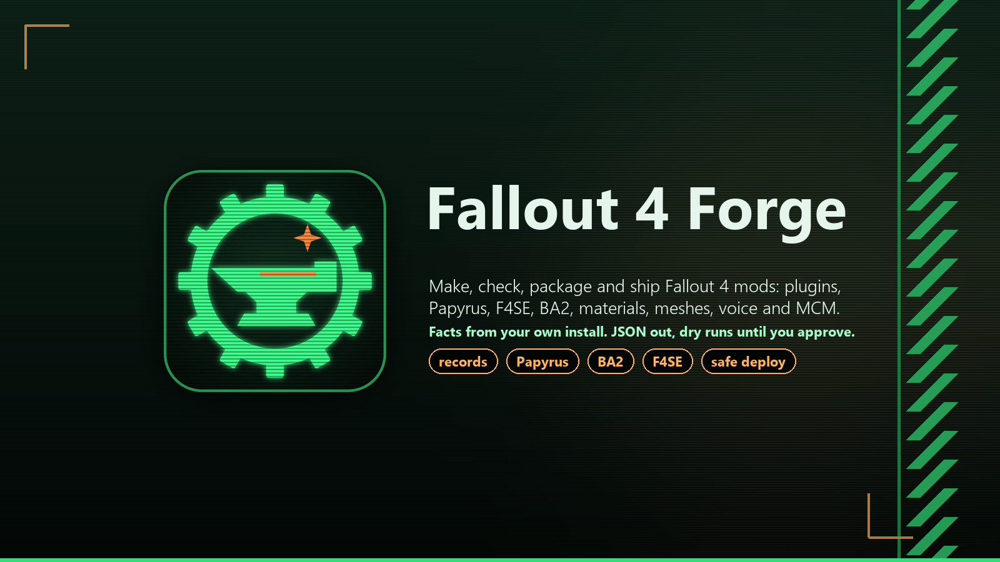
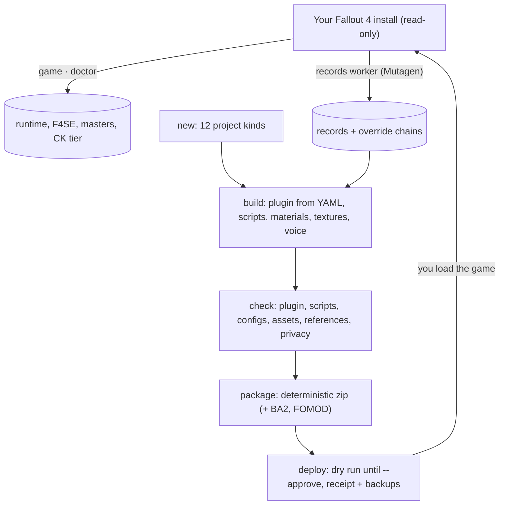

<div align="center">



[](https://github.com/SenjuWoo/Fallout4-Forge/actions/workflows/ci.yml)
[](https://github.com/SenjuWoo/Fallout4-Forge/releases)
[](pyproject.toml)
[](pyproject.toml)
[](LICENSE)

**[Install](#install)** · **[Tour](#a-two-minute-tour)** · **[Commands](#commands)** · **[How it works](#how-it-works)** · **[Evidence tiers](#evidence-tiers)** · **[Changelog](CHANGELOG.md)**

</div>

Fallout 4 Forge is a local-first toolkit for making, checking, packaging and shipping Fallout 4 mods. One CLI,
`f4forge`, prints JSON for every command, so people and AI agents can drive it the same way. Facts come from your
installed game: runtime and F4SE versions, the Address Library, official masters, the Creation Kit and the
frameworks next to them. Tools come from a pinned, hash-checked tool set.

## What you get

- **No guessed FormIDs.** A .NET records worker (Mutagen) finds, shows, overrides and creates records across your plugins, with override chains, and Spriggit turns plugins into a YAML tree you can diff.
- **Papyrus that compiles.** The official compiler when the Creation Kit is installed, Caprica when it is not, behind one diagnostics format; a PEX reader and a decompiler for the rest.
- **Archives and assets, checked.** BA2 read and write (GNRL and DX10) matching vanilla hashing and chunk layout, texconv presets by texture role, byte-exact BGSM/BGEM, NIF reference checks, Blender import/export through PyNifly, and FUZ/XWM/LIP voice files.
- **Framework configs validated.** MCM, RobCo Patcher, Base Object Swapper, LooksMenu presets, BodySlide XML and INI files, plus a CommonLibF4 template for native F4SE plugins.
- **Safe test installs.** The game folder, mod-manager staging, saves and INIs are read-only. Only `deploy` and `ck` write into the game, each a dry run until `--approve`, with a receipt, backups and an undo.
- **JSON everywhere.** Every command prints one JSON object with exit codes 0 ok, 1 findings, 2 a named failure with a fix, 3 a forge bug, and `--pretty` indents it.


## Install

Requirements: Windows, Python 3.10+, Fallout 4. Optional: the Fallout 4 Creation Kit (official compiler,
Archive2, voice tools), the .NET 9+ SDK (records worker), Blender (meshes), xmake and MSVC (native plugins).
`f4forge doctor` tells you which of them it found.

1. Download the source zip from the [latest release](https://github.com/SenjuWoo/Fallout4-Forge/releases/latest) and extract it next to your other modding tools.
2. Run `START-HERE.bat` (or `Install.ps1 -ToolsRoot <folder> -WorkspaceRoot <folder>`). It creates a virtual
   environment, installs the forge, runs the tests, adds `f4forge` to your user PATH, copies the agent skill
   into the AI tools it finds, and syncs the pinned tools into the tools folder.
3. Open a new terminal and run `f4forge doctor`.

Installer switches: `-SkipTools`, `-SkipTests`, `-NoAgentIntegration`, `-NoPath`, `-DryRun`. Running it again
converges and acts as the updater. `Uninstall.ps1` removes the launcher, the PATH entry and the skill copies
(`-KeepSkill` keeps them, `-RemoveHome` also removes the forge home); the checkout, its `.venv` and the tools folder
stay. Without installing, `f4forge.cmd` runs the forge from the checkout.

## A two-minute tour

```bat
f4forge doctor
f4forge plan "add a new weapon mod with an MCM menu"
f4forge records find --type WEAP --edid 10mm --plugins Fallout4.esm
f4forge new "My Mod" --kind plugin --kind papyrus --kind mcm
cd "My Mod"               :: the folder new printed (under the workspace root when one is set)
f4forge records new --type QUST --edid MyModQuest
f4forge build
f4forge check --compile
f4forge package
f4forge deploy            :: dry run; add --approve to copy into the game
```


## Commands

| Area | Commands |
|---|---|
| Health and routing | `doctor`, `game`, `plan "<request>"`, `knowledge <topic>`, `facts`, `capabilities`, `selftest` |
| Projects | `new <Name> --kind ...`, `templates`, `build`, `check [--compile]`, `package`, `validate`, `deploy`, `undeploy`, `bump` |
| Plugins and records | `plugin inspect\|esl-check\|export\|build`, `records find\|show\|override\|new\|conflicts\|validate`, `loadorder`, `index`, `conflicts` |
| Papyrus | `papyrus sources build`, `papyrus compile` (official compiler or Caprica), `papyrus decompile`, `papyrus pex` |
| Archives and assets | `ba2 list\|extract\|verify\|pack`, `tex inspect\|convert`, `material show\|build\|verify`, `nif info\|refs`, `mesh import\|export\|roundtrip`, `audio voice\|encode\|lip\|fuz\|unfuz` |
| Frameworks | `mcm`, `validate-config` (RobCo Patcher, Base Object Swapper, LooksMenu, BodySlide, INI), `native new\|build\|check` (CommonLibF4) |
| Creation Kit | `ck info\|precombine\|previs\|facegen\|ckpe-install` (dry run until `--approve`) |
| Logs and Nexus | `logs`, `explain "<error>"`, `nexus mod <id>`, `nexus find <name>`, `nexus page` |
| Tools, worker, settings | `tools status`, `tools sync --approve`, `worker build`, `config --set key=value` |

Project kinds: plugin, papyrus, mcm, robco, bos, f4se, textures, materials, mesh, looksmenu, bodyslide, audio.
`f4forge templates` lists what each one scaffolds.

## How it works



- **Tools are downloaded only by `tools sync --approve`**, verified by SHA-256 before extraction, into one tools folder that the forge owns through a receipt.
- **Facts are data with sources.** Every fact in `src/f4forge/knowledge/facts.json` names its tier (installed, primary, secondary, unverified) and source; unverified facts are never enforced. 28 knowledge topics ship with the tool (`f4forge knowledge`).
- **Packages are scanned** for private paths and API keys.

## Evidence tiers

Results name the tier they reached: static (`check`), compile (`check --compile`), package. Loading in game and
gameplay are never claimed by the forge; they stay `NOT RUN` until you test them.

## Tested

`python tests/run_tests.py` runs the offline suite on synthetic fixtures (never a game file). CI runs it on
Windows and Linux for Python 3.10, 3.13 and 3.14, scaffolds every project kind and packages it, builds the records
worker, compiles Papyrus with Caprica against stubs, builds the CommonLibF4 template, and installs and uninstalls
twice. Releases are `git archive` of a commit whose CI is green, built twice to prove identical bytes.

## Known gaps in 0.1

- Animation (HKX) and interface (SWF) are knowledge-only.
- Voice generation and precombine/previs runs need the Creation Kit.
- Archives written by the forge pass static and cross-tool checks; in-game loading is not tested by the forge.

## Licence

MIT (see [LICENSE](LICENSE)). Third-party tools keep their own licences ([THIRD-PARTY.md](THIRD-PARTY.md)).
Fallout 4 and the Creation Kit belong to Bethesda Softworks; this project is not affiliated with them. Agent
instructions: [AGENTS.md](AGENTS.md).
